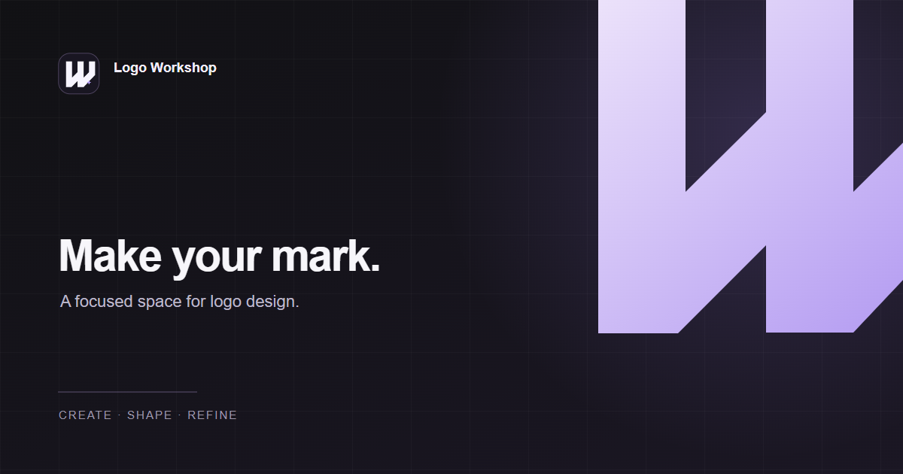

<div align="center">
  

# Logo Workshop

**A focused space for logo design.**

Create, shape and refine a mark without losing sight of the idea.
</div>

---

Logo Workshop is a browser-based editor built around one job: making logos. Draw a shape, bring in a reference, adjust the details, and export when it feels right. Your work stays in your browser unless you choose to export it.

> **A work in progress:** Logo Workshop is an early, local-first editor—not yet a full replacement for Figma. Please keep project backups and check the limitations below before relying on it for important work.

## Make something

- **Start with a shape.** Create basic shapes, draw straight or curved paths with the pen, and edit points and curve handles.
- **Bring in a reference.** Import supported SVGs or add PNG and JPG images. Turn a simple image into editable shapes with a preview before accepting it.
- **Make it your own.** Move, resize, rotate, recolor, group and ungroup parts. Use the scissors on supported shapes and lines, or combine supported filled shapes.
- **Find the right position.** Snap to object edges, centers and the export frame. The subtle dots are just a visual guide—not a snapping grid.
- **Add the finishing touches.** Add editable text, outlines, shadows and surface effects. Undo when you want to try something else.
- **Take it with you.** Export an SVG or PNG, or save a project backup to keep editing later.

## Start designing

1. Open Logo Workshop and start with the built-in example or a blank project.
2. Use the tools beside the canvas to create, select or edit shapes. Add text or import an image from **Add**.
3. Select an item to change its properties. Right-click a shape or layer for more actions.
4. Save a project backup while you work. When you're ready to share the artwork, choose **Export**.

**Keep a backup.** Autosave uses storage in your browser. Clearing browser data, switching browsers or moving to a different website address can make saved work unavailable. A project backup is the best way to keep an editable copy.

## Run it locally

You'll need [Node.js](https://nodejs.org/) and npm. This project has been tested with Node.js 24.

```bash
npm ci
npm run dev
```

Open the local address shown in the terminal. To make a production build:

```bash
npm run build
```

The built files are in `dist/`. The editor is a React, TypeScript and Vite app. Drawing, tracing and project storage run in the browser; there is currently no separate account service or hosted backend.

## What to know

- **Image tracing is an approximation.** It follows visible shapes; it cannot recover original layers, fonts or hidden details. Complex textures and gradients may not survive.
- **SVG import is intentionally limited.** Some SVG features—including text, gradients, embedded images and filters—are not supported. Exported SVGs with live text or effects may not reopen in the editor. Keep the project backup for further edits.
- **Scissors and groups have limits.** Scissors works on eligible ungrouped vectors; effects and some other cases are not supported. Group resize and rotation, nested groups and editable SVG patterns are not yet supported.
- **Text depends on available fonts.** It is single-line and uses a limited set of fonts; exported live text may look different on another device.
- **Storage and performance are bounded.** Projects, assets and shapes have size limits. Very large or complex designs may be slow.
- **AI and MCP are not connected yet.** The local automation workbench accepts validated commands, but there is no live MCP connection or hosted AI service.

## Help shape the workshop

Found a bug or have an idea? [Open an issue](https://github.com/twaseenmustafa/logo-workshop/issues) and describe what you were doing, what you expected, and what happened. If you can, include your browser and a screenshot **without private artwork or information**.

Contributions are welcome. For a larger change, open an issue first so we can discuss the approach. To check your changes locally:

```bash
npm run format:check
npm run typecheck
npm run lint
npm test
npm run build
npm run test:e2e
```

The browser tests use Playwright and an installed Chrome. Some tests write screenshots to `.internal_docs/verifications/`; create that folder if needed. More real-device, accessibility, security and large-document testing is still needed.

## License

The project is available under the [MIT License](LICENSE). Third-party dependencies have their own licenses; Paper.js attribution is included in `public/licenses/`.

---

<div align="center"><strong>Make your mark.</strong></div>
